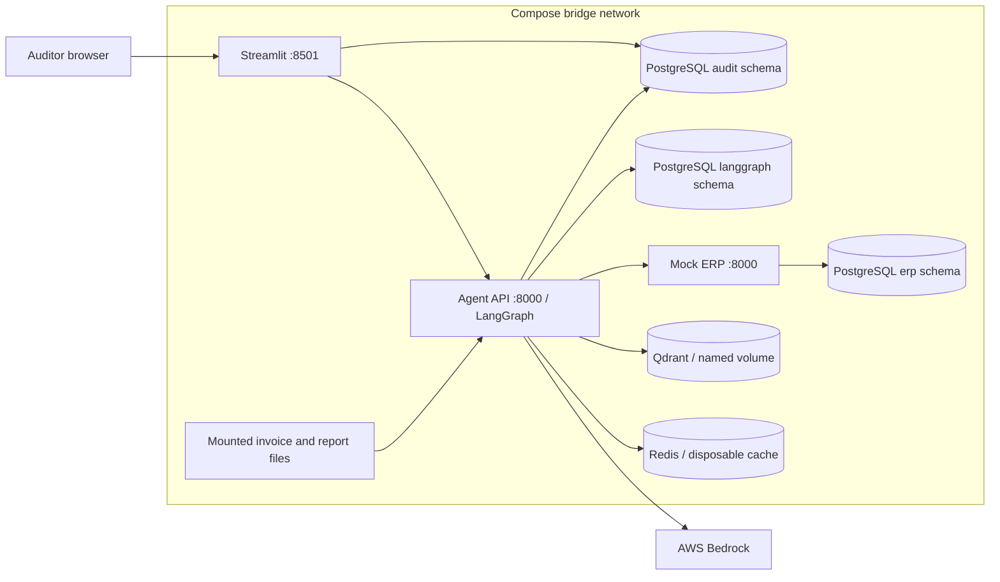

# Requirements, evidence and demonstration

## Scope

This document maps the supplied capstone specification to the current Group 14
implementation. An implemented feature is not automatically a verified feature.
Verification dates and evidence must accompany demonstration claims.

## Architecture and ownership



PostgreSQL's three schemas share one named-volume-backed database. The agent owns
application writes; the UI reads audit tables and calls the agent for mutations.
ERP lookups cross the HTTP boundary. Qdrant is derived from persisted text.

## Requirement matrix

| Requirement | Implementation / evidence | Status or boundary |
| --- | --- | --- |
| Monitor, checksum and failed-file events | `agents/monitor.py`, unique checksum column, watcher | Regression-tested duplicate and retry behavior; one ingestion process supported. |
| PDF, DOCX and PNG extraction | `agents/extractor.py`; Tesseract and Poppler installed in agent image | Real DOCX table parsing and PNG/scanned-PDF OCR passed on generated fixtures. Digital-PDF text-layer extraction was not separately exercised in this review. |
| Raw-text retention and reuse | `audit.invoice_audit.raw_extracted_text`; extraction reuse on retry | Regression test confirms stored text bypasses OCR/PDF reading. |
| Language detection and translation cache | `agents/translator.py`, Redis TTL | Implemented; low-confidence translations intentionally not cached. Live translation requires Bedrock access. |
| Completeness, arithmetic and tolerances | `config/rules.yaml`, data/business validation agents | Arithmetic regression tests; ERP comparisons use HTTP, not direct ERP SQL. Specification's `configs/` is named `config/` here. |
| Durable audit and typed fields | `db/init/20_audit_schema.sql` | NUMERIC amounts, DATE/TIMESTAMPTZ dates, separate line rows; transaction rollback integration test. |
| Human corrections | Append-only `human_feedback`, checkpoint resume and recheck | Original extraction retained. Validate browser workflow separately. |
| JSON/HTML reporting | Reporting agent; active `report.html` template | PostgreSQL is authoritative; file-write failure is logged. |
| RAG indexing and invoice filter | `rag_runtime.py` | Required payload fields implemented; embeddings require Bedrock. |
| Reflection threshold and retries | `reflection_node`, `after_reflection` | Both routes stop after at most three attempts. Only scores above 0.7 pass; unverified final answers are replaced by an explicit inability-to-verify response. Invalid/non-finite scores cannot pass. Regression-tested. |
| Structured questions through SQL | Parameterized audit queries supply structured context | Routing and answer wording still use the model; not a fully model-free SQL answer path. |
| Redis query cache | Versioned question, scope, model and audit-revision keys | Cache hit avoids RAG graph; audit logging still records each request. Reflection scores now retained in cached response. |
| LiteLLM / named model selection | Current ChatBedrock integration retained | Agreed deviation: project owner explicitly requested retention. |
| Six containers, service-name networking | `compose.yaml` | Current stack observed healthy; isolated verification checks DNS and durability. |
| Non-root containers and pinned images | Three Dockerfiles and image metadata | Existing application images report non-root users; agent image about 301 MB by Docker metadata. |
| Persistent Postgres/Qdrant, disposable Redis | Compose named volumes and Redis configuration | Isolated verifier tests retained state and inverse volume deletion with synthetic fixtures. |
| Clean startup | Automatic SQL initialization and health dependency conditions | Requires configured `.env`, AWS access for inference, and writable bind mounts. `--build` builds current source with isolated image tags; Docker may reuse dependency/base layers. |
| Secret handling | `.dockerignore`, runtime env and AWS mount | Source/image-history inspection is evidence, not proof of every historical image layer's contents. No real secrets included in deliverables. |

## Six demonstration checks

1. **Startup:** configure test credentials and writable folders, build all images,
   then show six healthy services. A fresh-build claim requires an actual build;
   the isolated verifier reuses installed images.
2. **Invoice processing:** upload a synthetic invoice with known ERP values. Show
   extracted text, translation, line items, findings and report. Record invoice ID,
   status and vector count. Do not substitute a mocked model for live evidence.
3. **Persistence:** recreate isolated containers without deleting volumes. Check the
   same invoice ID and vector count, then ask a question about that invoice.
4. **Deliberate loss:** delete only the isolated project's volumes and recreate it.
   Show empty audit tables and Qdrant collections. Bind-mounted files are separate:
   keep incoming empty to avoid automatic repopulation.
5. **Images:** inspect all three Dockerfiles, ignore files, runtime users, image
   sizes and image histories. Do not print runtime environments containing secrets.
6. **Networking:** resolve `postgres`, `qdrant`, `redis` and `mock-erp` from the agent;
   verify ERP endpoints use container port 8000, not host port 8001.

`scripts/verify_deployment.py` automates the storage/DNS parts in a uniquely named
project and removes only its own resources. Its output JSON is the test record.
The optional `--live` flag mounts runtime AWS credentials and processes a synthetic
German DOCX, calls the ERP, checks translation/report persistence and embeddings,
and asks a real RAG question. It incurs Bedrock usage and fails explicitly if live
translation, indexing or reflection acceptance is unavailable.

To reproduce the full isolated demonstration:

```sh
python scripts/verify_deployment.py --build --live --output /tmp/group14-final-verification.json
```

This command makes billable AWS requests and deletes only the uniquely named
verification project's volumes. Built verification image tags remain available
for inspection. It does not stop, rebuild or remove the normal Compose stack.

## Changes made during specification review

| Files | Change |
| --- | --- |
| `agent/app/main.py` | Restore missing `uuid` and `Path` imports used by upload/status endpoints. |
| `agent/app/agents/extractor.py` | Reuse stored extraction on failed-invoice retries instead of repeating OCR. |
| `agent/app/rag_runtime.py` | Keep reflection scores in responses/cache; validate finite score range; retry both routes up to the configured limit; withhold unsupported final answers. New query-cache namespace avoids old response shapes. |
| `.env.example` | Correct malformed introductory comment so it is a valid environment template. |
| `tests/test_backend_regressions.py` | Add upload, extraction reuse, score validation, retry and low-score-response checks. |
| `tests/test_document_extraction.py` | Exercise real document readers with generated DOCX, PNG and scanned-PDF fixtures. |
| `tests/live_invoice_check.py`, `tests/__init__.py` | Opt-in live German invoice and accepted RAG query check. |
| `scripts/verify_deployment.py` | Reproducible isolated startup, regression, DNS, live-processing and volume-lifecycle demonstration. |
| `README.md`, this file, `PRESENTATION.html` | Configuration guidance, requirements/evidence matrix and five-slide presentation. |

The earlier dead-code cleanup is retained: two uncalled UI helpers, an unused
checksum-cache write and the unreferenced Jinja template were removed. No working
dashboard interaction was removed during this review.

## Operational boundaries

- Multiple independent API/read services can scale, but the current ingestion
  lock is process-local. Multiple agent watchers require coordinated file claims.
- PostgreSQL and Qdrant need backups; named volumes are persistence, not backups.
- The default Compose deployment publishes local development ports. Authentication,
  TLS, restricted network exposure and separate database roles are deployment work.
- Redis failure is treated as degraded caching, not loss of audit correctness.
- LangGraph checkpoints resume work; they are not the audit record and must not
  replace typed business tables.
- “All checks passed” is appropriate only after live invoice, translation, RAG and
  dashboard demonstrations, not after container health or unit tests alone.
